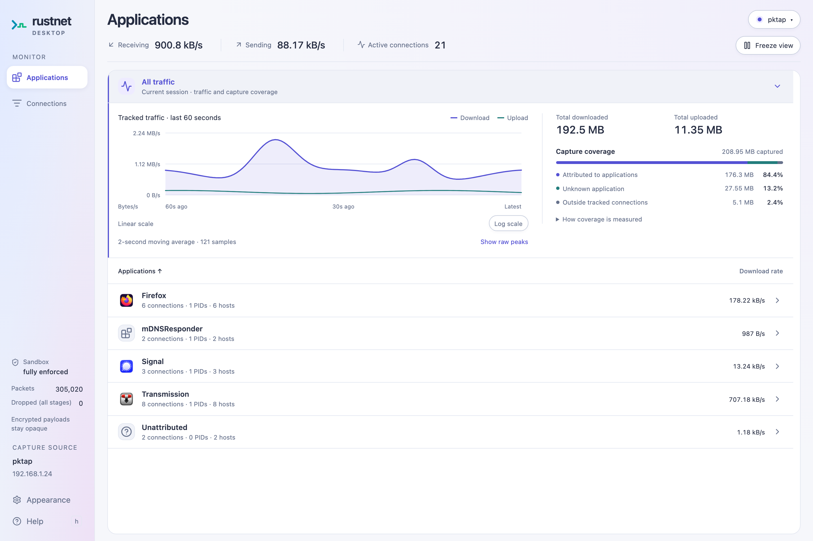
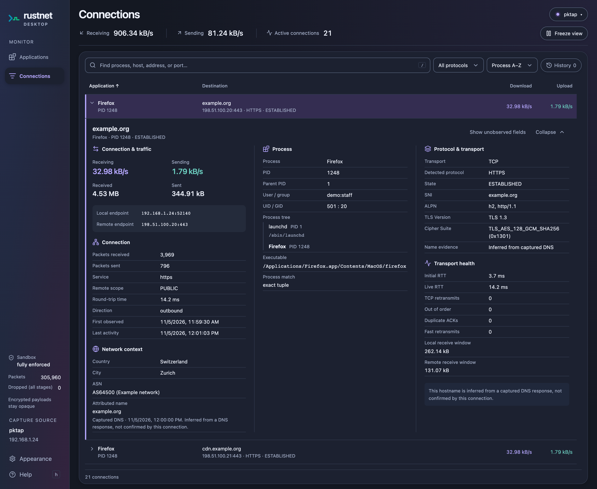

<p align="center">
  
</p>

<h1 align="center">RustNet Desktop</h1>

<p align="center"><strong>Alpha プレビュー</strong> · 現在開発中です。ソースからのビルドが必要で、不具合や仕様変更があり得ます。</p>

<p align="center">
  <strong>どのアプリが通信しているのか。ネットワークの動きを、ひと目で。</strong><br>
  RustNet ネットワーク監視エンジンのオープンソース・デスクトップ UI。
</p>

<p align="center">
  <a href="#試してみる">試してみる</a> ·
  <a href="#通信を調べる">通信を調べる</a> ·
  <a href="docs/GUIDE.ja.md">ドキュメント</a> ·
  <a href="https://github.com/domcyrus/rustnet-desktop/issues">フィードバック</a>
</p>

<p align="center">
  <a href="README.md">English</a> · <a href="README.zh-CN.md">简体中文</a> · <strong>日本語</strong>
</p>



<p align="center"><sub>Prism のライトテーマ。サンプル通信を使った Alpha プレビューです。</sub></p>

<details>
<summary>ダークテーマで接続の詳細と GeoIP 情報を見る</summary>



<p align="center"><sub>接続行の直下で通信量、TLS、GeoIP の国、都市、ネットワーク事業者を確認できます。サンプル通信と GeoIP データを使った Alpha プレビューです。</sub></p>

</details>

## 通信を調べる

帯域使用量が急増した原因のアプリを見つけ、接続先を確認し、そのまま接続の詳細を調べられます。
Rust と Tauri で構築し、[RustNet キャプチャエンジン](https://github.com/domcyrus/rustnet)を使用しています。

Alpha プレビューでは、次の機能を利用できます。

| 知りたいこと | 確認できる情報 |
| --- | --- |
| **どのアプリがネットワークを使っている？** | アプリ別のダウンロード・アップロード速度、アクティブ接続、直近 60 秒の通信グラフ。 |
| **どこに接続している？** | プロセス、ホスト名、IP、ポート、プロトコルで検索できる接続一覧。任意のローカル GeoIP データベースで、おおよその国・都市の位置情報とネットワーク事業者（ASN）を追加できます。 |
| **接続で何が起きている？** | 接続行の直下に詳細を開き、エンジンが観測できる範囲で DNS、TLS、プロセスのメタデータ、通信の状態を確認できます。 |
| **後から調査できる？** | 保持中の接続履歴を表示し、画面を一時停止したり、キャプチャ中に注釈付き PCAPNG を記録したりできます。 |

**GeoIP 情報を追加：** キャプチャ設定の **Choose GeoIP folder** で GeoLite2
データベースのフォルダーを選び、キャプチャを再開してください。macOS と Linux では
`~/.local/share/rustnet/geoip/` のデータベースを自動検出します。ファイル名とその他の
設定は [GeoIP の設定](docs/GUIDE.ja.md#geoip-データベース)を参照してください。

デスクトップは通常ユーザーで動作し、キャプチャ権限はエンジンが使用します。
キャプチャの内訳には、アプリを特定できない通信も表示します。プラットフォームごとの制限、
権限、カウンターの意味は[ガイド](docs/GUIDE.ja.md)を参照してください。

## 試してみる

**RustNet Desktop は Alpha プレビュー段階で、現在はソースからビルドする必要があります。**
使用するプラットフォーム上でビルドしてください。Git、Rust、Node.js 22.22.2+ または
24.15.0+ LTS、[pnpm 12.15.0](https://pnpm.io/installation)、
[各プラットフォームの依存関係](docs/GUIDE.ja.md#開発)が必要です。

```sh
git clone https://github.com/domcyrus/rustnet-desktop.git
cd rustnet-desktop
pnpm install --frozen-lockfile
pnpm run desktop
```

初回起動時に固定バージョンの RustNet エンジンを自動取得してビルドします。
エンジンを別途チェックアウトする必要はありません。
[キャプチャ権限](docs/GUIDE.ja.md#キャプチャ権限)を設定し、インターフェースを選んで **Start capture** を押してください。

| プラットフォーム | キャプチャ前の準備 |
| --- | --- |
| **macOS 13+** | Xcode Command Line Tools をインストールします。署名なしで PKTAP を使うには [sudo 開発ランチャー](BUILDING.ja.md#ビルド後の-sudo-キャプチャ)を使用します。sudo を使うのはエンジンだけです。 |
| **Linux** | WebKitGTK 4.1 と GTK 3 の開発パッケージをインストールし、[エンジンにキャプチャ用 capabilities を付与](docs/GUIDE.ja.md#キャプチャ権限)します。 |
| **Windows** | MSVC ツールチェーン、WebView2、通常ユーザーがアクセスできる Npcap をインストールします。 |

macOS と Linux の隔離ビルドは[ビルドガイド](BUILDING.ja.md)を参照してください。
Arch Linux では[コンテナビルド](BUILDING.ja.md#arch-linux-コンテナビルド)を使うと、ホストに Node.js や Rust をインストールする必要がありません。
ターミナル UI をお探しなら、[RustNet](https://github.com/domcyrus/rustnet)をお試しください。

## さらに詳しく

- [アプリの使い方](docs/GUIDE.ja.md#表示と記録)：画面、グラフ、検索、ショートカット、記録。
- [GeoIP の設定](docs/GUIDE.ja.md#geoip-データベース)：国、ASN、任意の都市情報を追加。
- [トラブルシューティング](docs/GUIDE.ja.md#linux-の描画トラブル)：Linux の描画問題。隔離ビルドは[ビルドとキャプチャのガイド](BUILDING.ja.md)も参照してください。
- [開発とパッケージ化](docs/GUIDE.ja.md#エンジンの開発と更新)：エンジン統合、[プロセス境界](docs/GUIDE.ja.md#プロセス境界)、[リリース前の検証](docs/GUIDE.ja.md#検証とパッケージ化)。
- [変更履歴](CHANGELOG.ja.md)：開発の進捗を確認。

## デスクトップ版を一緒に育てる

ビルドを試して、[うまく動いた点や困った点を教えてください](https://github.com/domcyrus/rustnet-desktop/issues)。
OS、操作手順、関連するエラー出力を添えていただけると助かります。
不具合報告、ドキュメントの改善、翻訳、コードの貢献を歓迎します。
[貢献ガイド](https://github.com/domcyrus/rustnet/blob/main/CONTRIBUTING.md)もご覧ください。
RustNet Desktop が役に立ったら、リポジトリに Star を付けたり、ネットワークの通信を
調べたい方に紹介したりしていただけるとうれしいです。

### ロードマップ：署名済みビルド

macOS と Windows 向けの署名済みバイナリを提供し、macOS 版の公証も行いたいと考えています。
実現には、コード署名にかかる費用を賄うために、ある程度の資金援助が必要になる可能性があります。
ご協力いただける方は、[こちらからご相談ください](https://github.com/domcyrus/rustnet-desktop/issues/new)。

[Apache-2.0 ライセンス](LICENSE) · [RustNet](https://github.com/domcyrus/rustnet) を基盤に開発
