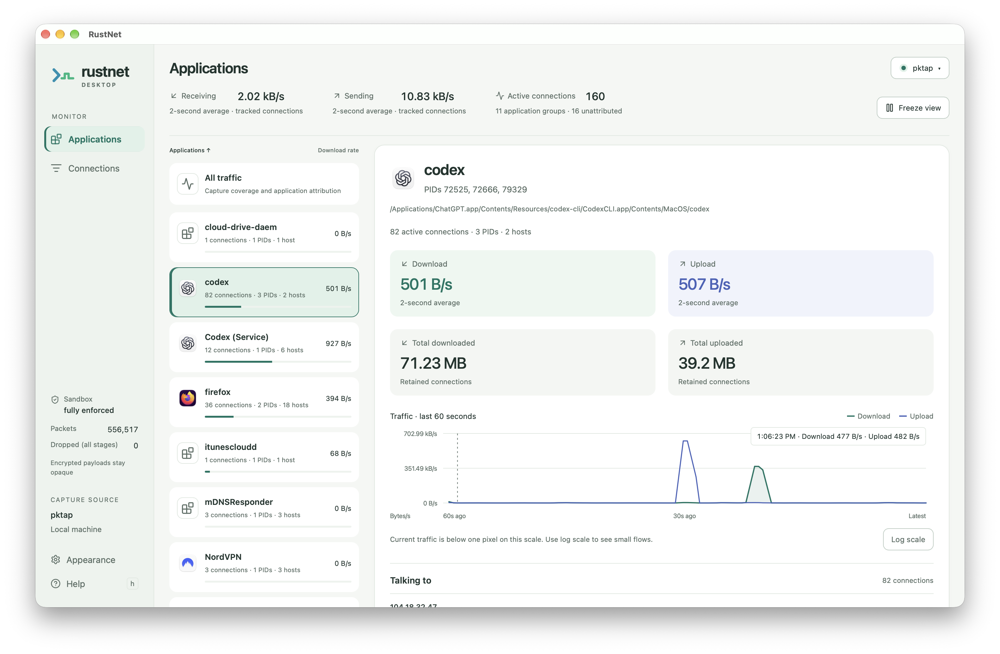

# RustNet Desktop（未リリース）

[English](README.md) | [简体中文](README.zh-CN.md) | [日本語](README.ja.md)

Tauri 2 を使った RustNet のデスクトップフロントエンドです。アプリ別の表示、接続表、
詳細パネル、トラフィックグラフは実際のバージョン 1 の headless スナップショットを
使用します。アプリにサンプルトラフィックは表示しません。



開発版プレビュー：macOS のアプリ別トラフィック表示（未リリース）。

## ロードマップ

macOS と Windows 向けの署名済みバイナリを提供し、macOS 版の公証も行いたいと考えています。
実現には、コード署名にかかる費用を賄うために、ある程度の資金援助が必要になる可能性があります。

## 開発

Rust、Node.js 22.22.2+ または 24.15.0+ LTS、既存の RustNet ビルド依存関係、
[Tauri のデスクトップ要件](https://v2.tauri.app/start/prerequisites/)を用意してください。
Linux は WebKitGTK 4.1 と GTK 3 の開発パッケージ、Windows は MSVC、WebView2、
Npcap が必要です。対象プラットフォーム上でビルドします。
[pnpm](https://pnpm.io/installation) 12.15.0（`package.json` で固定）をインストールしてください。
例: `npm install --global pnpm@12.15.0 --allow-scripts=pnpm`。このディレクトリで実行します。
macOS ビルドには macOS 13+ と Xcode Command Line Tools（`xcode-select --install`）が必要です。

macOS と Linux では `node scripts/isolated-build.mjs` で隔離ビルドを開始できます。
事前の依存関係インストールは不要です。[隔離ビルドと sudo キャプチャ](BUILDING.ja.md)を参照してください。
以下は通常のホットリロード開発手順です。

```sh
pnpm install --frozen-lockfile
pnpm run desktop
```

このリポジトリにはデスクトップ UI、Tauri ブリッジ、パッケージ設定を配置します。
キャプチャエンジンと TUI は [domcyrus/rustnet](https://github.com/domcyrus/rustnet) に残ります。
ビルドには Git が必要です。初回起動時に `engine.lock.json` で固定したコミットを取得し、
指定のパッチを検証して適用し、CLI をビルドして `src-tauri/binaries` にコピーします。
ソースは `.engine/` にキャッシュします。隣接する RustNet のチェックアウトは不要です。
`pnpm run dev` だけではレイアウトの確認のみ可能で、キャプチャには Tauri が必要です。

### エンジンの開発と更新

このリポジトリは、上流に未統合のインターフェース検出、制御パイプによる終了、
履歴、詳細メタデータ、キャプチャ範囲の統計を、一時的に
`engine/patches/0001-desktop-integration.patch` として保持します。元の変更は別途レビュー
するため RustNet のチェックアウトに残します。上流への統合後、`engine.lock.json` を
該当コミットに更新し、パッチ項目とファイルを削除してください。パッチには SHA-256
チェックサムがあり、変更時はロックファイルも更新します。デスクトップは schema 1 を
使用し、追加フィールドを許容します。エンジン更新時は下記のフロントエンドと Rust
ブリッジのテストを実行します。パッチは一時的な統合手段で、別のエンジン実装ではありません。

デスクトップは `--headless-details full` と `--capture-accounting` を明示的に有効にします。
通常のヘッドレス実行は上流の schema を維持し、追加の詳細フィールド生成とカバレッジ集計を省略します。
カバレッジは既存の累積キャプチャバイト数を再利用し、追跡済みおよびプロセス帰属済みの
フレームバイト合計を処理バッチごとに公開します。帰属はパケット処理時の情報に基づき、
後から判明したプロセスで過去の合計を変更しません。debug の代替エンジンも両オプションを
サポートする必要があります。更新後は古い同梱エンジンを再ビルドしてください。

ローカル開発では、`pnpm run desktop` の前に `RUSTNET_ENGINE_SOURCE` を上記変更を含む
RustNet のチェックアウトに設定してください。スクリプトはビルドだけを行い、パッチ適用や
Git 状態の変更は行いません。`RUSTNET_DESKTOP_ENGINE` で既存の互換バイナリを指定すると
エンジンビルドを省略します。どちらも debug 専用で、リリースは固定したエンジンを使用します。
キャッシュ内の変更は自動リセットせずエラーにします。`.engine/` を削除して再取得する前に
変更を保存してください。

## GeoIP データベース

エンジンは `~/.local/share/rustnet/geoip/`（または
`$XDG_DATA_HOME/rustnet/geoip/`）と標準システムディレクトリから GeoLite2
データベースを検索します。`GeoLite2-Country.mmdb`、`GeoLite2-ASN.mmdb`、
必要に応じて `GeoLite2-City.mmdb` を配置すると、TUI と共有できます。
端末の作業ディレクトリだけにあるファイルは、デスクトップでは見つからない場合があります。

キャプチャ設定の **Choose GeoIP folder** で、これらのファイルがあるフォルダーを
選択することもできます。一部のデータベースだけでも使用できます。選択は保存され、
絶対パスとしてエンジンに渡されます。キャプチャ中は **Apply and restart capture**
をクリックするか、新しくキャプチャを開始して読み込みます。
**Use automatic discovery** で既定の検索に戻せます。データベースのダウンロードや
デスクトップの権限昇格は不要です。都市データがない場合など、検索結果がなければ
該当項目は Unavailable のままです。

## キャプチャ権限

デスクトップは通常ユーザーで実行してください。キャプチャ権限が必要なのはエンジンだけです。
任意の macOS 開発モードではエンジンだけを sudo で起動します。
デスクトップは防火壁ルールの追加やエンジンのサンドボックス無効化を行いません。

- **Linux:** 最初のビルド後、[INSTALL.md](https://github.com/domcyrus/rustnet/blob/main/INSTALL.md) に従って同梱エンジンに
  capabilities を設定します。eBPF を使わない場合の例です。必要に応じてターゲット名を変更してください。

  ```sh
  sudo setcap cap_net_raw+eip src-tauri/binaries/rustnet-capture-engine-x86_64-unknown-linux-gnu
  ```

  コピーや再ビルドでファイルの capabilities は失われます。開発時は
  `RUSTNET_DESKTOP_ENGINE` に、互換性があり権限を設定済みの
  エンジンの絶対パスを指定できます。この指定は debug ビルド専用です。
  パッケージ版は隣接する同梱エンジンを使用します。権限設定は別のインストール手順であり、
  インストーラーが自動実行することはありません。
- **macOS:** PKTAP を使用するには、Developer ID で署名し公証したアプリを
  `/Applications` にインストールします。キャプチャ設定で **Enable capture helper** を選び、
  **System Settings > General > Login Items & Extensions** で RustNet Desktop を承認します。
  **Recheck helper status** を押し、**Automatic** を選んで開始します。
  `SMAppService` ヘルパーは同梱エンジンを root で起動し、エンジンはキャプチャを開いた後に
  ユーザー権限へ降格して厳格なサンドボックスを適用します。UI は通常ユーザーで動作します。
  現在のエンジンでは明示的なインターフェース指定で PKTAP は無効になります。
  停止後に **Remove capture helper** で解除できます。更新でヘルパーや launch-daemon plist が
  変わった場合は、解除して再度有効化します。sudo 開発モードを使わない開発版やアドホック署名版は通常の BPF と
  `lsof` による帰属を使用します。[INSTALL.md](https://github.com/domcyrus/rustnet/blob/main/INSTALL.md) に従って BPF 権限を設定してください。
  ChmodBPF だけでは PKTAP を利用できません。ヘルパー承認と BPF 権限は別の設定です。
- **Windows:** 通常ユーザーがアクセスできる Npcap をインストールします。
  管理者限定の構成では別途権限設定が必要です。
- **FreeBSD:** 既存の CLI は引き続き対応します。初版の Tauri デスクトップは対象外です。

インターフェースを選び **Start capture** を押します。権限、ドライバー、キャプチャの
エラーは画面に表示されます。OS によってプロセス帰属が制限されても、不明な接続は表示します。

## macOS sudo 開発モード

署名や公証なしで PKTAP を使うには、通常ユーザーで実行します。

```sh
node scripts/desktop-sudo.mjs
```

既存の debug ビルドで認証して起動し、ビルドとテストを省略するには `node scripts/desktop-sudo.mjs --no-build` を実行します。ソースや依存関係を変更した場合は再ビルドしてください。

隔離されたオフラインの debug ビルドとテストを完了してから sudo 認証を要求します。
その後はリソースを内蔵したデスクトップを直接起動し、開発サーバーやビルド監視は使いません。
**Automatic** を選んで開始してください。sudo を使うのはエンジンだけで、UI は通常ユーザーのままです。
認証を定期更新しません。前提条件、制限、再試行については[隔離ビルド](BUILDING.ja.md)を参照してください。
依存関係をインストール済みなら `pnpm run desktop:sudo` も別名として使えます。

## Linux の描画トラブル

ウィンドウ全体が応答しない、またはサイズ変更後に黒い領域が現れる場合は、
開発用ターミナルで Ctrl+C を押して停止し、次を試してください。

```bash
pnpm run desktop:linux-compat
```

この Linux 専用コマンドは起動時だけ `WEBKIT_DISABLE_DMABUF_RENDERER=1` を設定し、
[Tauri が説明する WebKitGTK の描画回避策](https://tauri-v2.netlify.app/develop/debug/linux-graphics/)
を試します。通常の起動、キャプチャ権限、サンドボックスは変更しません。
デスクトップの再起動が必要ですが、キャプチャエンジンの再ビルドは不要です。
改善しない場合は、別の回避策を試す前にターミナル出力と WebKitGTK・GPU ドライバーの
バージョンを収集してください。黒い領域だけでは正確な原因を確定できません。

## 表示と記録

- **Applications** は **All traffic** を開き、全体グラフ、追跡済みのセッション合計、
  接続/アプリ/ホスト数、キャプチャの内訳を表示します。アプリをクリックすると詳細を、
  ダブルクリックするとそのグループで絞った Connections を開きます。保持中の履歴も
  対象となり、**Clear filter** で全アプリに戻ります。
- **Connections** は連続スクロールの表です。プロセス、PID、ホスト名、IP、ポート、
  プロトコルで単語検索でき、TUI のフィルター式は使いません。アプリと接続は既定で
  名前順に並び、速度の見出しでリアルタイムの速度順に変更できます。
  接続をクリックして詳細を表示し、ダブルクリックで拡大します。
- インスペクターはプロセスの祖先、ユーザー/グループ、コンテナー情報、サービス/VLAN、
  ホスト名、GeoIP、DNS、TLS、通信の状態を表示します。未観測の情報は未取得のままです。
  Linux では起動時の実行ファイルパスを保持できますが、新規プロセスやアクセスできない
  プロセスでは取得できない場合があります。
- 区切りをドラッグするか左右矢印キーで詳細パネルの幅を変更します。広い場合は
  Overview、Process、Protocol を同時表示し、狭い場合はタブを使います。**Expand** で
  拡大し、閉じるか Escape でフィルターを保ったまま戻れます。
- 現在の速度は Unattributed を含む全画面で同じ 2 秒の移動平均を使います。初めて
  観測した既存接続は基準値を確立し、終了した接続は現在の合計から除外します。
  **Show raw peaks** は区間速度を、**Log scale** は小さな通信と大きなバーストを
  見やすく表示します。無効なスナップショットでは復旧まで直前の有効な表示を保持します。
- グラフは全アプリについて 60 秒間で最大 121 サンプルを保持し、別のアプリを表示中も
  継続します。新しいキャプチャではリセットします。**Freeze view** は表示のみを止め、
  キャプチャと記録は続きます。
- **Show breakdown graph** は捕獲済みと帰属済みの速度を比較します。内訳はリンク層
  ヘッダーを含む元のフレーム長で、帰属済み、追跡済みで帰属不明、追跡外に分けます。
  帰属はパケット処理時点で固定し、接続が期限切れになっても合計を保持します。
  追跡外には処理待ち、スキップ、キューでの破棄が含まれ、処理が進むと減る場合が
  あります。未配信のパケットは計測できず、VPN/全インターフェースでは重複計数も
  あり得ます。この合計は接続のバイトカウンターとは異なります。
- アプリのバイト合計はアクティブな接続と保持中の終了済み接続を含み、履歴の削除で
  減るため、完全なセッション累計ではありません。**Hosts** はポートに関係なく
  アクティブ接続の異なるリモート IP を数えます。アプリはプロセス名でまとめ、既知の
  異なる実行ファイルパスは区別します。パス不明で一意に判断できないものは別グループです。
- キャプチャ状態の横のソースボタンから設定を開きます。Linux は設定未保存で利用可能な
  場合、**All interfaces (any)** が既定です。macOS の **Automatic** はヘルパー有効時に
  PKTAP を試みます。保存済みのインターフェースが利用できない場合は選び直します。
  **Apply and restart capture** は旧セッションを正常終了して再開し、記録には新しい
  ファイルが必要です。**Stop capture** もここにあります。
- **History** (`t`) は保持中の終了済み接続の表示を切り替え、非表示でも件数は残ります。
  現在の合計は追跡中のアクティブ接続のみで、履歴の速度を含みません。エンジンが対応
  していればアイドル接続は薄くなり履歴化までの残り時間を示します。選択中と通信中の
  行は読みやすさを維持します。
- 開始前に **Record PCAPNG** を選び、保存ダイアログで未使用のファイル名を指定します。
  エンジンの注釈付き出力を使い、過去の通信は記録しません。停止すると書き込みを完了
  します。出力エラーやレコードの欠落があれば、不完全な記録の可能性があります。
- 外観、表示の選択、詳細パネルの幅、最後に正常に要求したインターフェースはローカルに
  保存します。UI は通信スナップショットを永続保存しません。サンドボックス状態と
  パケット数はサイドバーの Capture Source の上に表示します。
- マウスの戻る/進むと Alt+左/右で画面と選択を復元します。Connections では `/` で検索、
  `g`/`G` で最初/最後の行、`Ctrl+f`/`Ctrl+b` で次/前のページに移動します。
  ショートカットは現在のフィルターと並び順に従い、入力欄やドロップダウンを妨げません。
  Escape で詳細または外観パネルを閉じます。
- サイドバーの **Help** または `h` で現在の画面とショートカットの説明を開きます。
  キャプチャ設定と詳細パネルにも専用のヘルプがあります。

## プロセス境界

デスクトップは構造化された引数で、直接または承認済みの macOS ヘルパーを通じて同梱の `rustnet-capture-engine` のみを起動します。
`--list-interfaces` はキャプチャを開始せず JSON を返します。キャプチャは
`--headless --output jsonl --include-historic --stop-on-stdin-close` を使います。デスクトップがクラッシュ
した場合も、制御パイプの切断で CLI の通常の終了と出力フラッシュを要求します。
ウィンドウを閉じる際は終了を待ちます。15 秒以内に停止しない子プロセスは強制終了し、
記録が不完全な可能性を表示します。

macOS ヘルパーとアプリは、同じ Team ID と固定識別子の Developer ID 署名要件で XPC メッセージを認証します。
ヘルパーは長さを制限したインターフェース名と、既に開かれた記録/GeoIP の記述子だけを受け取り、
実行ファイルのパス、shell コマンド、任意の引数は受け付けません。降格先は認証済みの呼び出し元から取得し、
ユーザーごとに一つのキャプチャを許可し、XPC 切断で停止します。特権起動では同梱エンジンを root 専用の
ディレクトリへコピーし、署名を検証して保護されたコピーを実行します。debug 用エンジンの差し替えは拒否します。記録ファイルは通常ユーザーが排他的に作成し、
ユーザーの GeoIP 自動検出は記述子を渡す前にアプリが行います。

ブリッジは最新のスナップショットだけを保持し、1 レコードを 16 MiB に制限し、診断出力にも
上限を設けます。UI は 500 ms ごとに直列で取得し schema 1 を検証します。Connections は
連続した表で、アプリとその接続先リストは 1 ページ 75 件まで表示します。パケット解析、プロセス検索、権限破棄、サンドボックスは既存の
エンジンが担当します。Webview に shell や汎用ファイルシステムのプラグイン権限は付与しません。
防火壁とプロセス終了操作は初版に含まれません。

## 検証とパッケージ化

```sh
pnpm run prepare:engine
pnpm run build
pnpm test
pnpm run test:engine-source
pnpm run test:macos-helper
pnpm run test:application-icons
pnpm run check:engine
cargo fmt --manifest-path src-tauri/Cargo.toml --check
cargo clippy --locked --manifest-path src-tauri/Cargo.toml --all-targets -- -D warnings
cargo test --locked --manifest-path src-tauri/Cargo.toml
pnpm audit
cargo audit --file src-tauri/Cargo.lock
pnpm run bundle
```

`pnpm run bundle` は release CLI とデスクトップをビルドし、プラットフォームのパッケージに
エンジンを同梱します。本番用の署名、公証の資格情報、Linux/Windows のキャプチャ権限の自動設定は未構成です。
macOS ではヘルパーと launch-daemon plist も同梱します。PKTAP を有効化できるビルドには、
`pnpm run bundle` の前に `APPLE_SIGNING_IDENTITY` を Developer ID Application の署名 ID に設定し、
Tauri の公証資格情報（`APPLE_ID`、`APPLE_PASSWORD`、`APPLE_TEAM_ID`、または Apple API キー）を提供します。
詳細は [Tauri の署名と公証ガイド](https://v2.tauri.app/distribute/sign/macos/)を参照してください。
両方のサイドカーとアプリは識別子を維持し、同じ Team ID を使用する必要があります。
未署名やアドホック署名でもビルドできますが、特権ヘルパーは有効化できません。
`test:application-icons` は macOS、Linux、Windows でネイティブアイコンを検証します。Linux では
`xvfb`、`xauth`、SVG ローダー（Debian/Ubuntu では `librsvg2-common`）が必要です。
開発版はインストール済みのデスクトップエントリと現在の GTK テーマから Linux のアイコンを取得します。
Flatpak、Snap、shell ラッパー経由で起動するアプリは、実行ファイルを確実に照合できない場合、
従来のアイコンを表示することがあります。
Windows の開発版は実行ファイルからアイコンを取得し、必要に応じて PID からパスを解決します。
アクセスできないプロセスやアイコンを含まないファイルには従来のアイコンを表示します。

`test:macos-helper` は macOS で通常ユーザーのブローカー/記述子テストを行い、他の環境ではスキップします。
デーモンはインストールしません。署名済みの統合検証では承認後に Automatic を選び、
スナップショットの帰属方式が PKTAP であること、記録のフラッシュ、UI の終了、ヘルパー解除を確認します。
DMG 作成が Finder のレイアウト処理で停止する場合は、`CI=true pnpm run bundle` で外観設定をスキップできます。
エンジンを変更する場合は、RustNet リポジトリで [CONTRIBUTING.md](https://github.com/domcyrus/rustnet/blob/main/CONTRIBUTING.md) の検証も実行してください。

現在の Tauri の Linux 依存関係には、メンテナンス終了 crate と GLib
`VariantStrIter` の健全性問題（RUSTSEC-2024-0429）に関する RustSec 警告があります。
デスクトップの検証では警告を抑制しません。本番リリース前に上流の修正状況を確認してください。

## 依存関係の更新

GitHub Dependabot はルートの pnpm 依存関係、`src-tauri` の Cargo 依存関係、
GitHub Actions を毎日確認します。RustNet と同様に、メジャー更新も含めてエコシステム
ごとにグループ化します。パッケージ更新の待機期間は既定で 3 日、メジャー 7 日、
マイナー 4 日、パッチ 3 日です。セキュリティ更新には待機期間を適用しません。
マージ前に PR と CI の結果を確認してください。自動マージは設定せず、外部アプリの
インストールも不要です。

`engine.lock.json` と一時的なエンジンパッチは引き続き一緒に手動で管理します。
Dependabot はパッチ適用済みエンジンのコミットを更新しません。
