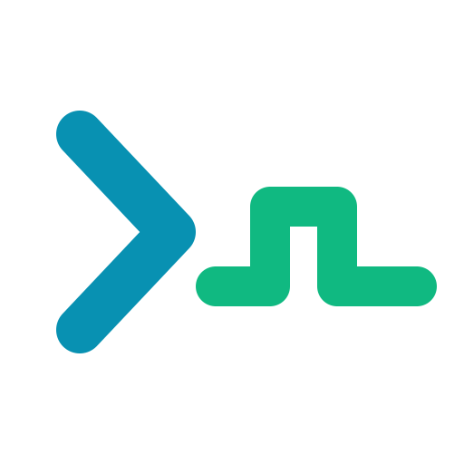
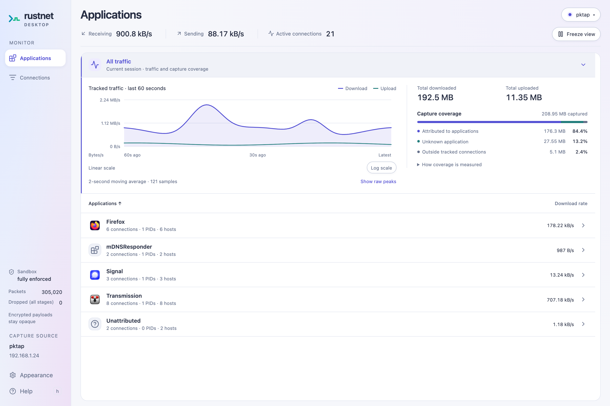
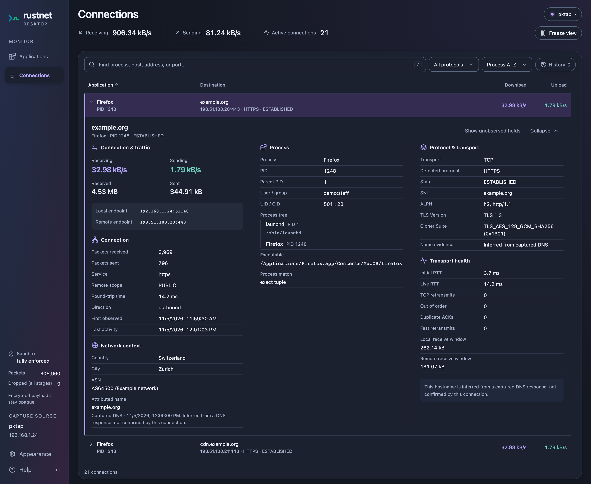

<p align="center">
  
</p>

<h1 align="center">RustNet Desktop</h1>

<p align="center"><strong>Alpha preview</strong> · Under active development. Build from source; expect bugs and changes.</p>

<p align="center">
  <strong>See which apps are talking. Understand your network traffic.</strong><br>
  An open-source desktop interface for the RustNet network monitoring engine.
</p>

<p align="center">
  <a href="#try-it">Try it</a> ·
  <a href="#explore-your-traffic">Explore your traffic</a> ·
  <a href="docs/GUIDE.md">Documentation</a> ·
  <a href="https://github.com/domcyrus/rustnet-desktop/issues">Feedback</a>
</p>

<p align="center">
  <strong>English</strong> · <a href="README.zh-CN.md">简体中文</a> · <a href="README.ja.md">日本語</a>
</p>



<p align="center"><sub>The Prism interface in light mode. Alpha preview with sample traffic.</sub></p>

<details>
<summary>Connection details and GeoIP in dark mode</summary>



<p align="center"><sub>Inspect traffic, TLS, and GeoIP country, city, and network operator directly beneath a connection. Alpha preview with sample traffic and GeoIP data.</sub></p>

</details>

## Explore your traffic

Find the app behind a bandwidth spike, see where it connects, and inspect the
connection without leaving the desktop. Built with Rust and Tauri, powered by
[the RustNet capture engine](https://github.com/domcyrus/rustnet).

The alpha preview includes:

| What you want to know | What you can explore |
| --- | --- |
| **Which app is using the network?** | Per-application download and upload rates, active connections, and 60-second traffic charts. |
| **Where is it connecting?** | Searchable connections with process, hostname, IP, port, and protocol details. Optional local GeoIP databases add approximate country/city location and network operator (ASN). |
| **What is happening on a connection?** | Expand inline details to inspect DNS, TLS, process metadata, and transport health where the engine can observe them. |
| **Can I investigate it later?** | Browse retained connections, freeze the view, or record annotated PCAPNG files during capture. |

**Add GeoIP context:** In capture settings, select **Choose GeoIP folder** and
choose your GeoLite2 database folder, then restart capture. On macOS and Linux,
`~/.local/share/rustnet/geoip/` is discovered automatically. See
[GeoIP setup](docs/GUIDE.md#geoip-databases) for database filenames and options.

The desktop runs as your regular user; capture permissions belong to the engine.
Capture coverage makes unattributed traffic visible too. See the
[guide](docs/GUIDE.md) for platform limits, permissions, and what the counters measure.

## Try it

**RustNet Desktop is an alpha preview, currently built from source.** Build on the
platform you intend to use. You'll need Git, Rust 1.89+, Node.js 22.22.2+ or 24.15.0+ LTS,
[pnpm 12.15.0](https://pnpm.io/installation), and the
[platform prerequisites](docs/GUIDE.md#develop).

```sh
git clone https://github.com/domcyrus/rustnet-desktop.git
cd rustnet-desktop
pnpm install --frozen-lockfile
pnpm run desktop
```

The first launch fetches and builds the pinned RustNet engine automatically.
No separate engine checkout is needed. Set up
[capture permissions](docs/GUIDE.md#capture-permissions), then choose an interface
and select **Start capture**.

| Platform | Before you capture |
| --- | --- |
| **macOS 13+** | Install Xcode Command Line Tools. For PKTAP capture without signing, use the [sudo development launcher](BUILDING.md#sudo-capture-after-building); only the engine uses sudo. |
| **Linux** | Install WebKitGTK 4.1 and GTK 3 development packages, then [grant the engine capture capabilities](docs/GUIDE.md#capture-permissions). |
| **Windows** | Install the MSVC toolchain, WebView2, and Npcap. Launch normally; starting capture requests UAC approval for the engine only. |

For an isolated build on macOS or Linux, follow the [build guide](BUILDING.md).
For Arch Linux, the [container build](BUILDING.md#arch-linux-container-build) keeps Node.js and Rust off the host.
Prefer a terminal interface? Try [RustNet](https://github.com/domcyrus/rustnet).

## Go further

- [Using the app](docs/GUIDE.md#views-and-recording): views, charts, search, shortcuts, and recording.
- [GeoIP setup](docs/GUIDE.md#geoip-databases): add country, ASN, and optional city lookups.
- [Troubleshooting](docs/GUIDE.md#linux-rendering-troubleshooting): Linux rendering issues; [build and capture guidance](BUILDING.md) for isolated builds.
- [Development and packaging](docs/GUIDE.md#engine-development-and-updates): engine integration, [process boundaries](docs/GUIDE.md#process-boundary), and [release checks](docs/GUIDE.md#verify-and-package).
- [Changelog](CHANGELOG.md): follow development progress.

## Help shape the desktop

Try a build and [tell us what worked or where you got stuck](https://github.com/domcyrus/rustnet-desktop/issues).
Include your OS, the steps you followed, and any relevant error output.
Bug reports, documentation improvements, translations, and contributions are welcome.
See the [contribution guidelines](https://github.com/domcyrus/rustnet/blob/main/CONTRIBUTING.md).
If RustNet Desktop is useful to you, star the repository or share it with someone
who wants to understand their network traffic.

### Roadmap: signed builds

We would like to provide signed binaries for macOS and Windows, including macOS
notarization. This may require some funding to cover code-signing costs.
If you'd like to help, [start a conversation](https://github.com/domcyrus/rustnet-desktop/issues/new).

[Apache-2.0 licensed](LICENSE) · Built on [RustNet](https://github.com/domcyrus/rustnet)
