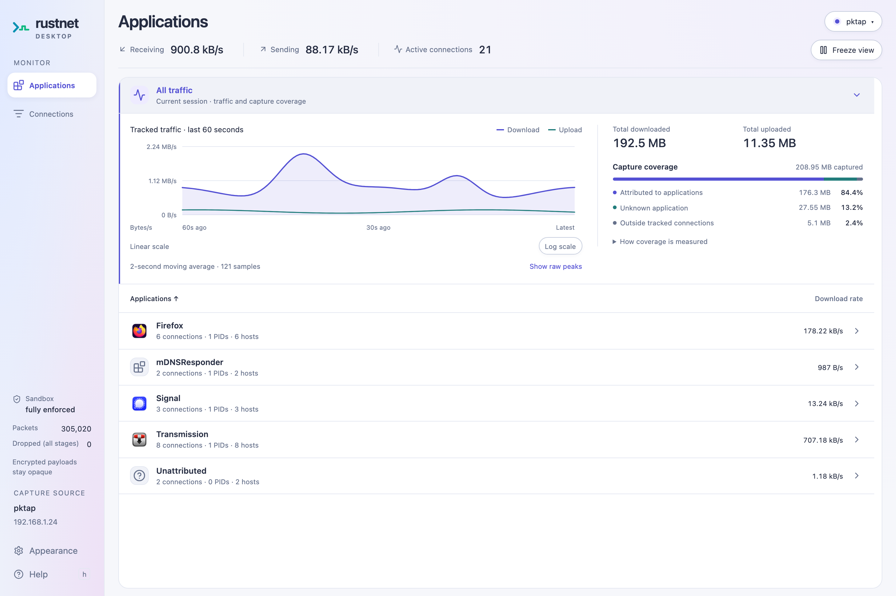
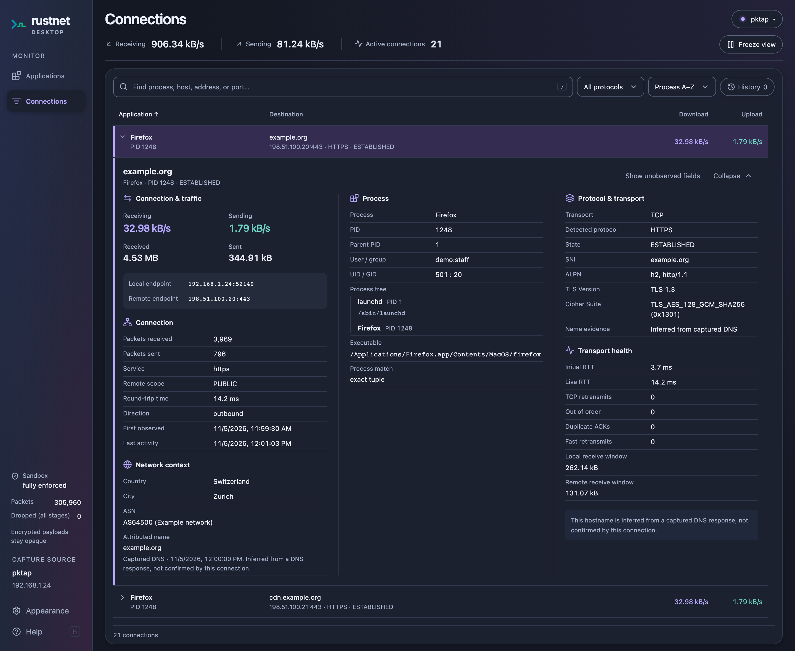

<p align="center">
  
</p>

<h1 align="center">RustNet Desktop</h1>

<p align="center"><strong>Alpha 预览版</strong> · 正在积极开发中，需从源码构建，可能存在问题并随时发生变化。</p>

<p align="center">
  <strong>看清哪些应用在联网，了解每一段网络流量。</strong><br>
  RustNet 网络监控引擎的开源桌面界面。
</p>

<p align="center">
  <a href="#开始体验">开始体验</a> ·
  <a href="#探索网络流量">探索网络流量</a> ·
  <a href="docs/GUIDE.zh-CN.md">文档</a> ·
  <a href="https://github.com/domcyrus/rustnet-desktop/issues">反馈</a>
</p>

<p align="center">
  <a href="README.md">English</a> · <strong>简体中文</strong> · <a href="README.ja.md">日本語</a>
</p>



<p align="center"><sub>Prism 浅色界面。Alpha 预览版，使用示例流量。</sub></p>

<details>
<summary>查看深色模式下的连接详情与 GeoIP 信息</summary>



<p align="center"><sub>直接在连接行下方查看流量、TLS，以及 GeoIP 国家、城市和网络运营商信息。Alpha 预览版，使用示例流量与 GeoIP 数据。</sub></p>

</details>

## 探索网络流量

找到带宽突增背后的应用，查看它连接的目标，并直接在桌面界面中检查连接。
使用 Rust 和 Tauri 构建，由 [RustNet 抓包引擎](https://github.com/domcyrus/rustnet)驱动。

Alpha 预览版提供：

| 想了解什么 | 可以查看什么 |
| --- | --- |
| **哪个应用正在使用网络？** | 各应用的下载与上传速率、活跃连接，以及最近 60 秒的流量图。 |
| **它正在连接哪里？** | 可搜索的连接列表，包含进程、主机名、IP、端口和协议信息。可选的本地 GeoIP 数据库提供大致的国家、城市位置及网络运营商（ASN）信息。 |
| **连接上发生了什么？** | 在连接行下方展开详情，在引擎能够观测的范围内查看 DNS、TLS、进程元数据和传输健康信息。 |
| **能否留待后续分析？** | 浏览保留的历史连接、冻结视图，或在抓包期间录制带注释的 PCAPNG 文件。 |

**添加 GeoIP 信息：** 在抓包设置中点击 **Choose GeoIP folder**，选择 GeoLite2
数据库所在目录，然后重新开始抓包。在 macOS 和 Linux 上，应用会自动发现
`~/.local/share/rustnet/geoip/` 中的数据库。文件名及其他选项见
[GeoIP 配置](docs/GUIDE.zh-CN.md#geoip-数据库)。

桌面应用以普通用户运行，抓包权限由引擎使用。覆盖统计也会展示无法归属到应用的流量。
各平台的限制、权限和计数含义见[指南](docs/GUIDE.zh-CN.md)。

## 开始体验

**RustNet Desktop 目前处于 Alpha 预览阶段，需要从源码构建。** 请在目标平台上构建。
需要 Git、Rust 1.89 或更新版本、Node.js 22.22.2+ 或 24.15.0+ LTS、
[pnpm 12.15.0](https://pnpm.io/installation) 和[平台依赖](docs/GUIDE.zh-CN.md#开发)。

```sh
git clone https://github.com/domcyrus/rustnet-desktop.git
cd rustnet-desktop
pnpm install --frozen-lockfile
pnpm run desktop
```

首次启动会自动获取并构建固定版本的 RustNet 引擎，无需单独检出引擎仓库。
配置[抓包权限](docs/GUIDE.zh-CN.md#抓包权限)后，选择接口并点击 **Start capture**。

| 平台 | 抓包前的准备 |
| --- | --- |
| **macOS 13+** | 安装 Xcode 命令行工具。无需签名的 PKTAP 抓包可使用 [sudo 开发启动器](BUILDING.zh-CN.md#构建完成后使用-sudo-抓包)，仅引擎使用 sudo。 |
| **Linux** | 安装 WebKitGTK 4.1 和 GTK 3 开发包，然后[授予引擎抓包 capabilities](docs/GUIDE.zh-CN.md#抓包权限)。 |
| **Windows** | 安装 MSVC 工具链、WebView2，以及允许普通用户访问的 Npcap。 |

macOS 和 Linux 的隔离构建方式见[构建指南](BUILDING.zh-CN.md)。
Arch Linux 可使用[容器构建](BUILDING.zh-CN.md#arch-linux-容器构建)，无需在宿主机安装 Node.js 或 Rust。
更喜欢终端界面？试试 [RustNet](https://github.com/domcyrus/rustnet)。

## 深入了解

- [使用应用](docs/GUIDE.zh-CN.md#视图与录制)：视图、图表、搜索、快捷键和录制。
- [GeoIP 配置](docs/GUIDE.zh-CN.md#geoip-数据库)：添加国家、ASN 及可选的城市查询。
- [故障排查](docs/GUIDE.zh-CN.md#linux-渲染故障排查)：Linux 渲染问题；隔离构建另见[构建与抓包指南](BUILDING.zh-CN.md)。
- [开发与打包](docs/GUIDE.zh-CN.md#引擎开发与更新)：引擎集成、[进程边界](docs/GUIDE.zh-CN.md#进程边界)和[发布检查](docs/GUIDE.zh-CN.md#验证与打包)。
- [更新日志](CHANGELOG.zh-CN.md)：了解开发进展。

## 一起完善桌面版

试用构建版本，并[告诉我们哪些地方好用、哪里遇到了困难](https://github.com/domcyrus/rustnet-desktop/issues)。
请附上操作系统、操作步骤和相关错误输出。欢迎提交问题、改进文档、完善翻译或贡献代码。
参与前请阅读[贡献指南](https://github.com/domcyrus/rustnet/blob/main/CONTRIBUTING.md)。
如果 RustNet Desktop 对你有帮助，欢迎为仓库点亮 Star，或分享给希望了解网络流量的人。

### 路线图：签名版本

我们希望为 macOS 和 Windows 提供签名二进制文件，并为 macOS 版本完成公证。
这可能需要一些资金支持，以支付代码签名相关费用。
如果你愿意提供帮助，欢迎[发起讨论](https://github.com/domcyrus/rustnet-desktop/issues/new)。

[Apache-2.0 许可证](LICENSE) · 基于 [RustNet](https://github.com/domcyrus/rustnet)
